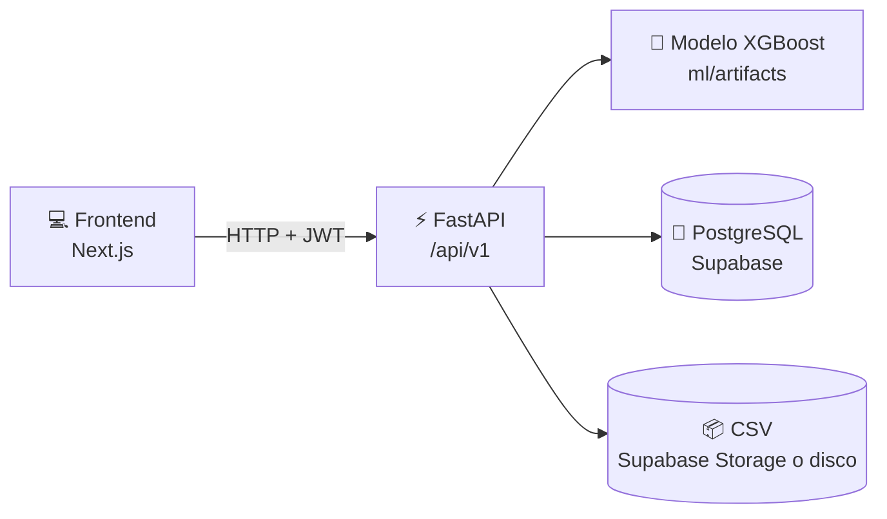

<div align="center">


<a href="https://huggingface.co/spaces/Crypt0xDev/backend-fraud-detector">
  
</a>

<br/>

[](https://www.python.org/)
[](https://fastapi.tiangolo.com/)
[](https://xgboost.readthedocs.io/)
[](https://supabase.com/)
[](#-docker)
[](#-licencia)

<a href="https://huggingface.co/spaces/Crypt0xDev/backend-fraud-detector"></a>
<a href="https://github.com/Crypt0xDev/ml-fraud-training"></a>
<a href="https://github.com/Crypt0xDev/frontend-fraud-detector"></a>

</div>

---

## 📖 Sobre el proyecto

Analiza transacciones financieras y detecta posibles fraudes con un modelo **XGBoost** entrenado con el dataset [PaySim](https://www.kaggle.com/datasets/ealaxi/paysim1/data) (**6,3 millones** de transacciones).

<table>
  <tr>
    <td align="center" width="25%">🔍<br/><b>Predicción</b><br/><sub>Probabilidad y nivel de riesgo, con las variables que influyeron</sub></td>
    <td align="center" width="25%">📄<br/><b>Lotes CSV</b><br/><sub>Hasta 10.000 filas, con descarga de resultados</sub></td>
    <td align="center" width="25%">🗂️<br/><b>Historial</b><br/><sub>Lotes y predicciones por usuario</sub></td>
    <td align="center" width="25%">🔐<br/><b>Seguridad</b><br/><sub>Roles y permisos, JWT y contraseñas con scrypt</sub></td>
  </tr>
</table>



## 🧰 Tecnologías

<div align="center">


</div>

## 🚀 Inicio rápido

> Necesitas [Python 3.14](https://www.python.org/downloads/), [Git LFS](https://git-lfs.com/) y una base PostgreSQL (local o Supabase).

```cmd
git lfs install
git clone https://github.com/Crypt0xDev/backend-fraud-detector.git
cd backend-fraud-detector
python -m venv .venv
.venv\Scripts\activate
python -m pip install --upgrade pip
pip install -r requirements.txt
copy .env.example .env
uvicorn main:app --reload --reload-include "*.joblib" --reload-include "*.json"
```

Completa `DATABASE_URL` y `JWT_SECRET` en `.env` antes de arrancar. En macOS / Linux activa con `source .venv/bin/activate` y copia con `cp`.

<div align="center">

📚 **Documentación de la API:** http://localhost:8000/docs

</div>

## ⚙️ Variables de entorno

Todas están en [`.env.example`](.env.example). Las principales:

| Variable | Para qué sirve |
| --- | --- |
| `DATABASE_URL` | Sin ella no hay login ni historial. En Supabase: Connect → Transaction pooler |
| `JWT_SECRET` | Secreto usado para firmar los tokens JWT. |
| `SUPABASE_URL` · `SUPABASE_SECRET_KEY` | Project Settings → API Keys |
| `MAX_PREDICT_ROWS` | Límite de transacciones por petición (100 por defecto); los CSV usan su propio límite. |
| `ADMIN_USERNAME` · `ADMIN_PASSWORD` | Admin inicial, solo si no hay ningún root; los demás usuarios se crean desde la API. |
| `TRUSTED_PROXIES` | IPs del frontend (por defecto `127.0.0.1,::1`). Solo a ellas se les cree `X-Forwarded-For` para limitar los intentos de login por IP real; en Docker, pon la IP del contenedor del frontend. |
| `DOCS_ENABLED` | `true` por defecto. Con `false` se apagan `/docs`, `/redoc` y `/openapi.json`; conviene en producción. |

> [!IMPORTANT]
> Nunca subas tu `.env` al repositorio: tiene contraseñas y claves.

## 📁 Estructura

```text
 ┣ 📜 main.py          # Punto de entrada
 ┣ 📂 app/             # Un módulo por carpeta: auth, user, role, prediction, batch, model...
 ┣ 📂 config/          # Variables de entorno, base de datos, rutas y datos iniciales
 ┣ 📂 utils/           # Tokens, contraseñas, límites y carga del modelo
 ┣ 📂 ml/artifacts/    # Modelo entrenado
 ┗ 📂 tests/           # Pruebas con pytest
```

## 🛠️ Comandos

```bash
pytest                                    # pruebas (SQLite temporal, no toca tu base)
pyright main.py app config utils          # revisión de tipos
python -m app.user.create_user <usuario>  # crear usuario o cambiar su contraseña
```


## 🐳 Docker

```bash
docker build -t backend-fraud-detector .
docker run -p 8000:8000 --env-file .env backend-fraud-detector
```

## 📄 Licencia

[MIT](LICENSE) · Universidad Nacional de San Martín · Tarapoto · Perú


